# Student Dropout Prediction: An Early-Warning System for Murphys Polytechnic Institute

Which students are about to leave without a degree, what puts them at risk, and who should advisors talk to first?
This project answers those questions with the public **Predict Students' Dropout and Academic Success** dataset:
**4,424 students** of a Portuguese polytechnic, of whom **about one in three dropped out**. It builds a
**Random Forest** model that flags students at risk at the end of their first year, while there is still time to help.

The analysis lives in [`notebooks/student_dropout_prediction.ipynb`](notebooks/student_dropout_prediction.ipynb).
This README retells the notebook in plain language, section by section, without any code. The exported model and an
engineered copy of the data power a Streamlit early-warning app for advisors and academic leadership of the fictional
**Murphys Polytechnic Institute** in [`app/`](app/).

[](https://murphys-polytechnic-dropout.streamlit.app/)

**Try the app:** open the live demo at
[murphys-polytechnic-dropout.streamlit.app](https://murphys-polytechnic-dropout.streamlit.app/), or run it on your
own computer in a few commands (see [How to Run](#how-to-run)). The live demo can take a few seconds to wake up after a
quiet period.

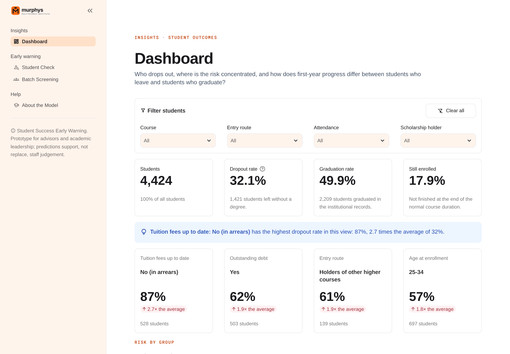

## At a glance

| Question | Answer |
|---|---|
| How many students drop out? | **32.1%** (1,421 of 4,424). Another 17.9% had not finished by the end of the normal course duration, and 49.9% graduated. |
| Who drops out most? | Students with **tuition fees in arrears** (86.6% dropped out, 2.7 times the average), **debtors** (62.0%), students who passed **few first-year units** (median first-year approval rate 25%, against 100% for graduates), and **mature entrants** (55.4% on the "over 23" entry route). |
| Who drops out least? | **Scholarship holders** (12.2%) and **Nursing** students (15.4%). |
| How good is the early warning? | It catches **76.1% of the students who later drop out**, and **83.7%** of the students it flags actually drop out. A simple rule (no second-semester unit passed, or fees in arrears) catches 66.2% with 83.2% correct flags. |
| What drives the model? | The **first-year approval rate** (share of enrolled units passed) and **tuition-fee status**, by a wide margin. |
| What should the institution do first? | Review academic progress at the **end of semester 1**, contact students **as soon as fees fall into arrears**, give **mature and evening students** a tailored onboarding, and run a **supervised one-semester pilot** of the dropout flag. |

### How the notebook is organised

The work follows **CRISP-DM**, a standard step-by-step method for data projects: understand the problem, understand
the data, prepare it, build models, evaluate them, and put them to use.

| # | Section | What it covers |
|---|---|---|
| 1 | [Project Overview](#1-project-overview) | Why dropout matters and how high it is here |
| 2 | [Business Understanding](#2-business-understanding) | Problems, goals, people involved, and how success is measured |
| 3 | [Setup](#3-setup) | The tools used |
| 4 | [Data Understanding](#4-data-understanding) | Where the data comes from, how clean it is, and what it shows |
| 5 | [Data Preparation](#5-data-preparation) | Turning the records into something a model can learn from, without cheating |
| 6 | [Modelling](#6-modelling) | Building and tuning the first model |
| 7 | [Evaluation](#7-evaluation) | How well it works on unseen students, and a second, improved iteration |
| 8 | [Deployment](#8-deployment) | The exported model and the early-warning app |
| 9 | [Conclusion and Recommendations](#9-conclusion-and-recommendations) | What it all means and what to do about it |

To run the app or the tests yourself, see [How to Run](#how-to-run).

The notebook departs from the textbook order of CRISP-DM in a few places, on purpose:

* **Codes are turned into categories early (Section 4.2).** Columns such as course or marital status are stored as
  numbers but are labels, so they are converted before exploring the data.
* **New features are explored as soon as they are built (Section 5.1).** Each engineered feature is followed by its
  own chart and insight.
* **The dashboard data is exported before model-specific steps (Section 5.2)**, so the app shows values in their
  original units.
* **Evaluation loops back to modelling.** The first model narrowly missed its targets, so a second iteration
  (Section 7.8) re-models, chooses on cross-validation, and evaluates the final model once more.

---

## 1. Project Overview

**Roughly one in three students in this dataset never finishes their degree, and most of the warning signs are
visible within the first year.**

**Dropout is costly for everyone involved.** Each student who leaves means lost tuition revenue and under-used
teaching capacity for the institution, and time and money spent without a qualification for the student.

**It is a widespread problem.**

* Across OECD countries, only **39%** of full-time bachelor's entrants graduate within the theoretical duration of
  their programme. The completion rate rises to **68%** three years later, and **12%** of entrants leave before the
  start of their second year (OECD, 2022).
* In Portugal, where the data comes from, half of the students were still enrolled at the end of the theoretical
  duration, and the share who left without a degree grew by a further 8 percentage points over the next three years
  (OECD, 2022).

**Why an early warning helps.** Dropout research has long linked persistence to how well a student is integrated
academically and socially (Tinto, 1975). In practice, institutions often notice disengagement only after grades or
payments have already failed. Models trained on administrative records can surface the signals earlier, so tutors
and support services can step in while the student can still be retained (Martins et al., 2021; Realinho et al.,
2022).

**What this project delivers.** For advisors and academic leadership, it answers three practical questions:

1. How many students drop out, and which groups carry the most risk?
2. Which academic, financial and demographic factors go with dropping out?
3. Which individual students should advisors contact, before they leave?

All sources are listed under [References](#references).

---

## 2. Business Understanding

**Support often starts too late when the first warning is a student who has stopped attending or paying.** An early
warning at the end of the first year gives advisors and support offices time to act.

### 2.1 Problem Statements

1. **At-risk students are not identified early enough to intervene.** About one in three students dropped out, and
   dropout is typically recognised only after a student has stopped attending or paying.
   *At stake:* lost tuition revenue, lower completion rates, and students leaving without a qualification.
2. **The factors behind dropout are not measured.** Advisors and support services lack evidence on which academic,
   financial and demographic signals matter most.
   *At stake:* support budgets spent on the wrong students or the wrong kind of help.
3. **There is no tool for monitoring student status.** Insights live in one-off analyses rather than in a tool staff
   can use every semester.
   *At stake:* the analysis cannot be repeated or acted on consistently.

### 2.2 Goals

Each goal answers one problem. The codes in brackets refer to the success criteria in Section 2.4.

1. **Predict each student's final status and catch dropouts better than a simple rule** [D1, D2, D3]. Build a
   Random Forest that predicts Dropout, Enrolled or Graduate from first-year records.
2. **Find and rank the factors linked to dropout in terms staff can act on** [B2, D4].
3. **Deliver one Streamlit application** [B1, B3] with an analytics dashboard on the engineered data and a prediction
   prototype on the exported model.

### 2.3 Situation Assessment

**Who uses the results, and for what.** The institution is fictional, so this map is a proposal based on how student
success programmes are usually organised.

| Stakeholder | Decision supported | What they use |
|---|---|---|
| Academic Affairs leadership (Vice-Rector) | Retention targets, intervention budget, policy on sensitive attributes | Dashboard page, conclusions in Section 9 |
| Academic advisors / tutors (**main users**) | Which students to contact each semester, and how | Student Check and Batch Screening pages |
| Student Financial Services | Payment plans, emergency grants, scholarship outreach | Financial risk factors, app predictions |
| Admissions office and programme directors | Onboarding for high-risk entry routes and courses | Dropout rates by entry route and course |
| Data and IT team | Model maintenance, retraining and monitoring | Notebook, model files, metadata |

**Resources**

* **Data:** one table of 4,424 students and 37 columns.
* **Tools:** Python (pandas, scikit-learn, Matplotlib, seaborn), Optuna for tuning, and Streamlit for the app.

**Requirements, assumptions and constraints**

* **Prediction point.** The model uses first- and second-semester results, so predictions are made **at the end of
  the first academic year**, not at enrollment.
* **What the label means.** Status is recorded at the end of the normal course duration (three years; four for
  Nursing). "Enrolled" therefore means *not yet finished*, not a final outcome.
* **Proxy data.** The records come from a Portuguese polytechnic (2008/09 to 2018/19) and stand in for the
  institution's own records.
* **No dropout reason.** Voluntary withdrawal and dismissal cannot be told apart.
* **Fairness.** Gender, marital status and nationality are sensitive attributes. They are analysed, but their use in
  individual decisions needs a policy decision.

**Risks and how the notebook handles them**

| Risk | How it is handled |
|---|---|
| The model "sees the answer" and looks better than it is (data leakage) | Split the data before any step that learns from it; fit all preparation inside the model pipeline |
| Fewer Enrolled students, so the model ignores them | Stratified split, balancing of the training students only, and scores that weight every status equally |
| Financial status may be recorded close to the outcome | Kept, but flagged for a timing check with the registrar |
| Proxy data differs from the institution's students | Retrain and re-check on the institution's own records before use |
| Unfair treatment of sensitive groups | Review error rates per group; an advisor reviews every flag |

### 2.4 Success Criteria and Evaluation Metrics

Success is judged in two ways: does the project help the **people** who use it (business criteria), and are the
**analytical results** good enough (data-mining criteria)? Both are fixed before modelling and checked in
Sections 7.5 and 7.8.

**A useful model must beat what the institution could do without it.** The data suggests a simple rule: **flag every
student who passed no second-semester unit or has fees in arrears**. The model is measured against this rule, and
against the naive choice of predicting "Graduate" for everyone.

**Business success criteria**

| ID | Objective | Success means |
|---|---|---|
| B1 | Advisors receive a ranked list of at-risk students each semester | The model is exported and usable by the app |
| B2 | Dropout drivers are explained in terms staff recognise | Top factors reported with direction and size |
| B3 | The dashboard shows data in original units | Engineered data exported and loadable by the app |

**Data-mining success criteria** (measured on the test students, who keep the real mix of statuses)

| ID | Goal | Criterion | Target |
|---|---|---|---|
| D1 | 1 | Catch most dropouts | Dropout recall **0.75 or more**, and above the business rule |
| D2 | 1 | Balanced quality across all three statuses | Macro F1 **0.70 or more**, and above the "everyone graduates" benchmark |
| D3 | 1 | Results hold on new students | Gap between cross-validation and test score of **5 points or less** |
| D4 | 2 | Drivers agree with the exploration | Top factors in the model match the exploratory findings |

**How performance is measured**

* **Recall (Dropout):** of all students who drop out, the share the model flags. A missed student is the costliest
  error, so this is the main measure.
* **Precision (Dropout):** of all flagged students, the share who actually drop out. Low precision wastes advisor
  time.
* **F1:** a balance of precision and recall. **Macro F1** averages F1 over the three statuses with equal weight, so
  the smaller Enrolled group counts as much as the others.
* **Accuracy:** the share of all predictions that are right. Reported for completeness, but misleading when one
  status is much more common than the others.

### 2.5 Solution Approach

**A. Describing and explaining the data (Goal 2)**

* **Dropout rates** for every group of every characteristic, with **lift** (the group's rate divided by the overall
  rate).
* **Statistical tests** of whether characteristics are linked to status: a likelihood-ratio test for numbers and a
  chi-square test for categories.

**B. Predicting status with machine learning (Goal 1)**

* **Leakage-safe preparation** in four phases (Section 5), so no information from the test students reaches the
  model.
* **Method:** **Random Forest**, which builds many decision trees on random subsets of students and characteristics
  and combines their votes. It handles mixed numbers and categories, captures combined effects (for example, low
  grades *and* fees in arrears), and needs no rescaling.
* **Tuning** with **Optuna**, scored with **5-fold stratified cross-validation**, and every trial logged to a JSON
  file.
* **Explaining the model** with permutation importance on the original characteristics.

**C. Delivery (Goal 3):** one Streamlit app with a dashboard on the exported data and prediction pages on the exported
model (Section 8).

---

## 3. Setup

This section only prepares the working environment, so it is not part of the CRISP-DM method.

* **Tools:** Python, with **pandas** and **NumPy** for data handling, **Matplotlib** and **seaborn** for charts,
  **SciPy** for statistical tests, **scikit-learn** for preparation and modelling, **Optuna** for tuning, and
  **joblib** for saving the model.
* **Version checks:** the notebook checks that each library is recent enough and stops with a clear message if one is
  too old. Exact versions are pinned in `requirements.txt`; the final run used scikit-learn 1.6.1, pandas 2.2.3 and
  Optuna 5.0.0.
* **One place for settings:** every project-wide setting is defined once, including the random seed, file paths, the
  columns to exclude and the tuning search space.

---

## 4. Data Understanding

### 4.1 Data Source

| Dataset | One row per | Rows | Columns | What it contains |
|---|---|---|---|---|
| Predict Students' Dropout and Academic Success (Realinho et al., 2021), via the Dicoding mirror; CC BY 4.0 | Student | 4,424 | 37 | Enrollment, demographics, family background, finances, first- and second-semester results, three economic indicators, and the final status |

The records were collected at the Polytechnic Institute of Portalegre (Portugal) for students who enrolled between
2008/09 and 2018/19. The file is semicolon-separated.

### 4.2 Data Description

The 37 columns fall into clear groups, and each has a role in this project:

| Group | Examples | Role |
|---|---|---|
| Enrollment | Entry route (application mode), choice order, course, daytime or evening attendance, previous qualification and its grade, admission grade | Features; entry route **excluded** by the author (see Section 5.6) |
| Demographics | Gender, age at enrollment, marital status, nationality, international, displaced (studying away from home), special educational needs | Features; nationality, international and special needs **dropped** after testing (Section 5.8) |
| Family background | Mother's and father's qualification and occupation | **Excluded:** sensitive, with dozens of sparse codes |
| Finances | Debtor, tuition fees up to date, scholarship holder | Features |
| First-year results | Per semester: units credited, enrolled, evaluated, passed (approved), without evaluation, and average grade | Features, plus engineered ratios (Section 5.1) |
| Economy | Unemployment rate, inflation rate, GDP growth | **Excluded:** they describe the year a student enrolled, not the student |
| Status | **Dropout, Enrolled or Graduate** | The target |

Many columns are stored as numbers but are **codes for categories**, for example course 9500 = Nursing or marital
status 1 = single. Averaging such codes is meaningless, so they are converted to categories. One column name in
Portuguese spelling (`Nacionality`) is renamed to `Nationality`.

### 4.3 Data Quality

* **Missing values:** none.
* **Duplicate rows:** none.
* **Two grade scales.** Previous-qualification and admission grades use a 0–200 scale, while semester grades use
  0–20. This matters when the two are compared (Section 5.1).
* **Mostly-zero counts.** Credited units and units without evaluation are zero for most students, with a few large
  values.
* **Sparse codes.** Some categories are dominated by one code (3,919 of 4,424 students are single), while others,
  such as parents' occupation, have dozens of codes with very few students each.

**Bottom line:** the data is clean. Sparse groups make rates unstable, so groups with fewer than 50 students are
hidden in rate tables.

### 4.4 Exploring the Data

The exploration answers eight questions:

1. How large is dropout, and how balanced are the statuses?
2. Which academic indicators separate dropouts from other students?
3. Are demographics and family background related to dropout?
4. Does age at enrollment matter?
5. How are finances related to dropout?
6. Do entry route and course matter?
7. Do economic conditions matter?
8. Do living away from home and special educational needs matter?

Most findings use the **dropout rate**: the share of students in a group who dropped out. The overall 32.1% is the
benchmark. Raw counts mostly show how large a group is; rates show where risk is concentrated.

#### How many students drop out?

* **About one in three.** 2,209 students graduated (49.9%), 1,421 dropped out (32.1%) and 794 were still enrolled
  (17.9%).
* **The figure is plausible.** Across the OECD, only 68% of bachelor's entrants complete within the theoretical
  duration plus three years. The numbers are not directly comparable, because the label here is measured at the end
  of the normal course duration at a single institution.

**What this means:** the statuses are moderately unbalanced, and "Enrolled" is the smallest and least final group. The
model needs a stratified split, balancing of the training students only, and scores that weight every status
equally.

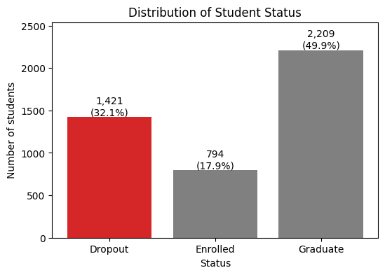

#### Academic progress in the first year

* **Dropouts pass far fewer units.** The median number of passed units is 2 for dropouts against 6 for graduates in
  semester 1, and **0 against 6** in semester 2.
* **About 40% of dropouts passed no unit in semester 1, and 51% none in semester 2.**
* **Prior grades barely separate the groups:** admission-grade medians are 123.6 for dropouts and 127.4 for
  graduates.

A grade of 0 often means a student stopped attending, so low second-semester results may be a *symptom* of a decision
already taken rather than its cause.

**What this means:** first-year progress is the clearest signal, and an academic review at the end of semester 1 is
feasible.

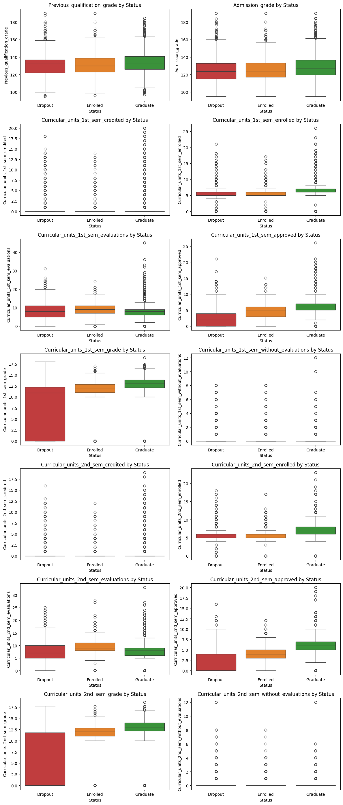

#### Demographics and family background

* **Counts are dominated by the largest groups** (single, Portuguese, daytime, domestic students), so most dropouts
  naturally fall in those groups.
* **Rates tell a different story:** male students drop out at **45.1%** against 25.1% for female students, married
  students at 47.2% against 30.2% for single students, and evening students at 42.9% against 30.8% for daytime
  students.
* **International students do not differ** (29.1% against 32.2%).

These groups overlap. Gender is linked to course choice (Nursing, for example, has a low dropout rate), and evening
attendance is linked to older, working students. The rates are links, not causes.

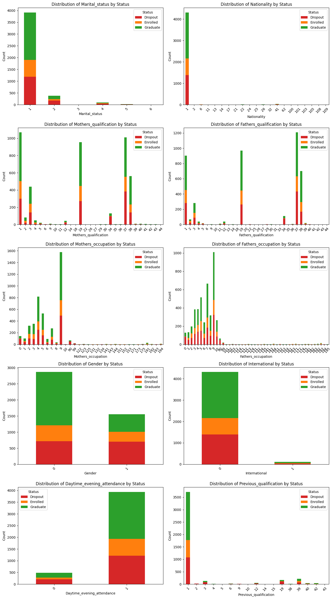

#### Age at enrollment

* **Dropouts enroll older:** median age 23 for dropouts, 20 for enrolled students and 19 for graduates.
* **But half of the dropouts are 23 or younger;** only the oldest quarter is above 30.

Age overlaps with the "over 23" entry route and with evening attendance. Competing work and family commitments are a
plausible explanation the data cannot test.

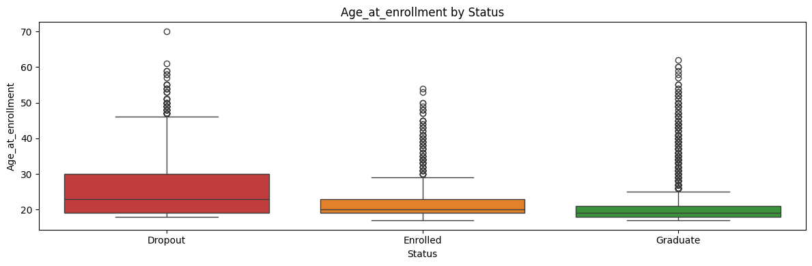

#### Finances

* **Tuition fees in arrears are the sharpest marker:** **86.6%** of those students dropped out (528 students),
  against 24.7% of students whose fees are up to date. That is **2.7 times** the average.
* **Debtors:** 62.0% against 28.3%.
* **Scholarship holders drop out far less:** 12.2% against 38.7%.

The dataset does not say *when* fee status is recorded. If fees stop being paid after a student has decided to leave,
fee status partly describes the outcome rather than predicting it. The scholarship effect may also reflect selection,
because scholarships often go to stronger students.

**What this means:** finances are the most actionable lever for Student Financial Services, provided a timing check
confirms that fee status is known before dropout.

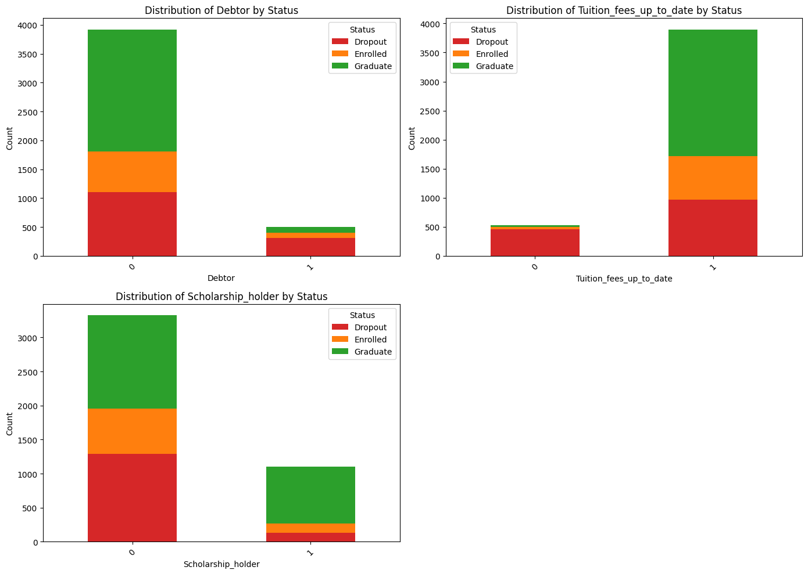

#### Entry route and course

* **Entry route matters:** holders of another higher-education degree drop out at **61.2%** and "over 23" entrants at
  **55.4%**, against 20.2% for the general first-phase route.
* **Course matters:** the highest rates are in Equinculture (55.3%), Informatics Engineering (54.1%) and Management
  (evening, 50.7%); the lowest in Nursing (15.4%) and Social Service (18.3%).
* **Choice order looks odd:** first-choice applicants drop out at 34.8% against 22–27% for later choices, probably
  because of the mix of entry routes among them.

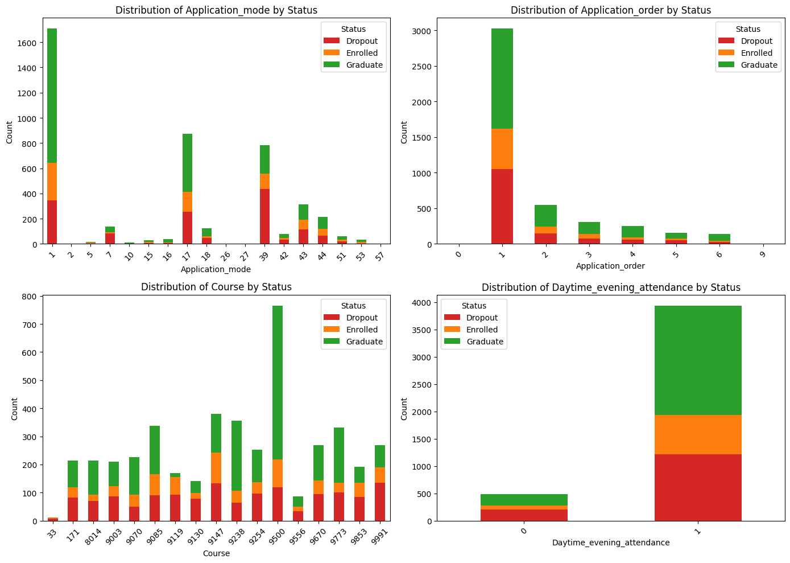

#### Economic conditions

* **The three indicators take only 10 distinct combinations** across 4,424 students. They were added from a national
  statistics source and describe the **year a student enrolled**, not the student.
* Differences in their medians mostly show which enrollment years each group belongs to.

**What this means:** these columns are not actionable for an individual student and are left out of the model.

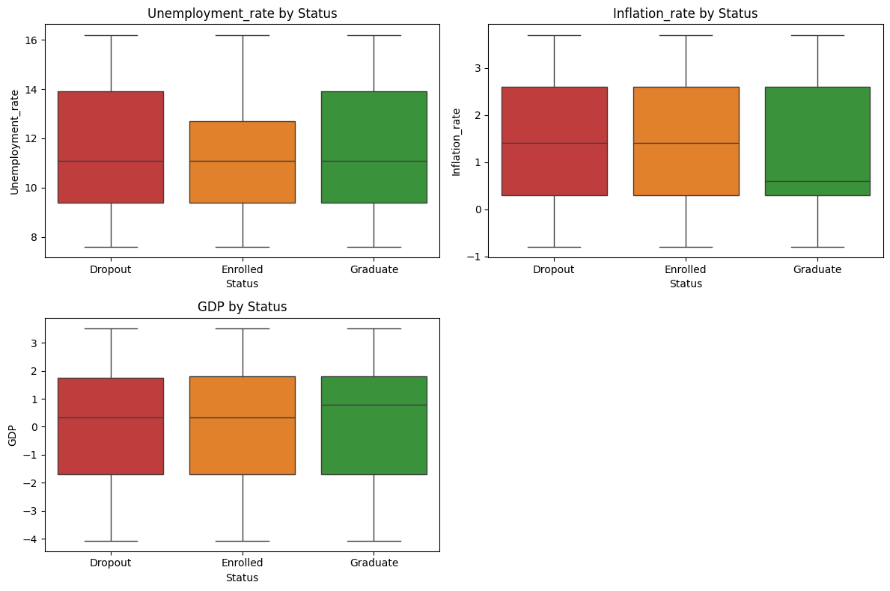

#### Living away from home and special needs

* **Students living away from home drop out less:** 27.6% against 37.6%. This may be confounded with age and entry
  route, since mature entrants are likely to live locally.
* **Special educational needs show no difference** (33.3% against 32.1%), and the group is small (51 students).

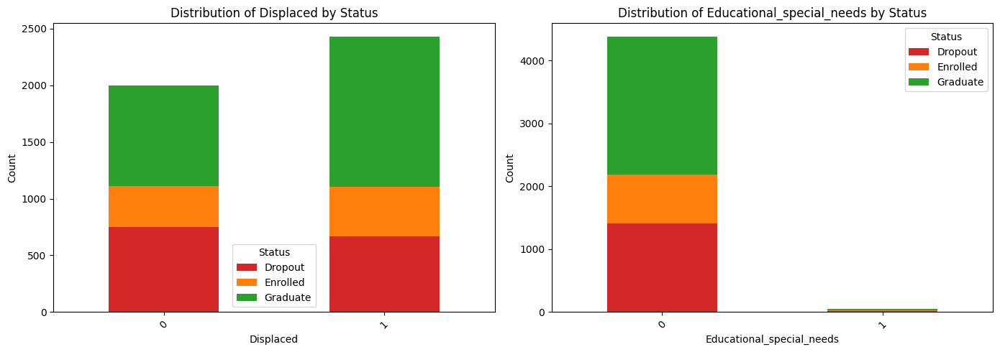

#### Summary of the exploration

1. **Baseline.** 32.1% of students dropped out; Enrolled is the smallest group (17.9%).
2. **Academic drivers.** Passed units and grades in **both** first-year semesters separate dropouts most clearly;
   prior grades barely do.
3. **Financial drivers.** Fees in arrears (86.6%), debt (62.0%) and no scholarship (38.7%) mark high risk, subject to
   a timing check.
4. **Background.** Higher rates for male, married, older and evening students, and large differences by entry route
   and course.
5. **Weak or unusable signals.** Economic indicators describe enrollment years; nationality, international status and
   special needs show no clear link.

### 4.5 From Exploration to Preparation

| What the exploration found | What the preparation does |
|---|---|
| Passed units depend on how many units a student enrolled in | Build approval rates, grade averages and related ratios |
| Grades use 0–200 and 0–20 scales | Rescale the previous-qualification grade before comparing |
| Count columns are mostly zero with long tails | Log-transform right-skewed, non-negative columns |
| Economic indicators describe enrollment years; family background is sensitive and sparse | Exclude them |
| Moderately unbalanced statuses | Stratified split; balance the training students only |
| Some categories show no link to status | Test every category on the training students and drop the unlinked ones |
| Many sparse category codes | Use an encoder that tolerates codes not seen in training |
| Fee status may be recorded late | Keep it, and flag the timing check as a limitation |

---

## 5. Data Preparation

The preparation runs in **four phases**. The guiding rule is that **every step that learns something from the data is
fitted on the training students only** and then applied unchanged to the test students, so the test stays a fair
simulation of new students.

An earlier version of this notebook balanced the statuses *before* splitting and sampled with replacement, so copies
of the same student appeared in both the training and the test data. That inflated the test accuracy to 79.5%; the
corrected order gives an honest 74.5% for the same kind of model (Section 7.2).

### 5.1 Phase A: Building New Features

Every new feature is calculated from a student's own record, row by row, so it can be built before the split without
leaking information.

| Feature | How it is calculated | What it shows |
|---|---|---|
| **Semester approval rate** | Units passed ÷ units enrolled, per semester | Median in semester 2: **0.00** for dropouts, 0.69 for enrolled, 1.00 for graduates |
| **Overall approval rate** | Average of the two semester rates | Median 0.25 for dropouts against 1.00 for graduates |
| **Share of units without evaluation** | Unevaluated units ÷ enrolled units, per semester | About twice as common among non-graduates (8.7% against 4.5%), but rare |
| **Change in units without evaluation** | Semester 2 share minus semester 1 share | Mostly zero; adds no information |
| **Overall average grade** | Grade average across both semesters, weighted by passed units | Median 11.0 for dropouts against 13.0 for graduates |
| **Grade against prior level** | Overall average grade minus the previous-qualification grade (rescaled from 0–200 to 0–20) | Graduates perform close to their prior level (−0.4); dropouts fall well below it (−2.3) |
| **Approved-to-credited ratio** | Passed units ÷ units credited from earlier studies | Applies to only 13.6% of students |

* A rate of 0 covers both students who passed nothing and the 180 students who enrolled in **no** units (42.8% of
  whom dropped out). Two different situations share one value.
* **Many academic features are near-duplicates.** 58 pairs of numeric features are strongly correlated
  (|r| ≥ 0.6), for example the overall and semester-2 approval rates (r = 0.97). This is mostly by construction:
  ratios repeat the counts they are built from. Random Forest predictions are not harmed, but the credit for a
  prediction is split among them, so the model is explained with permutation importance (Section 7.4).

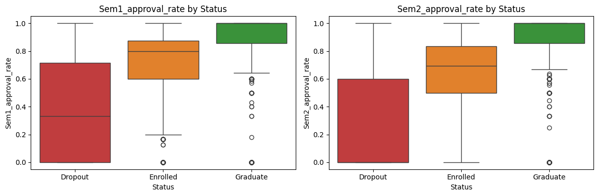

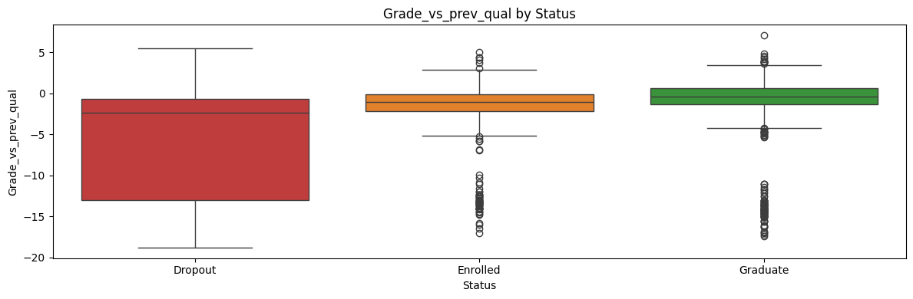

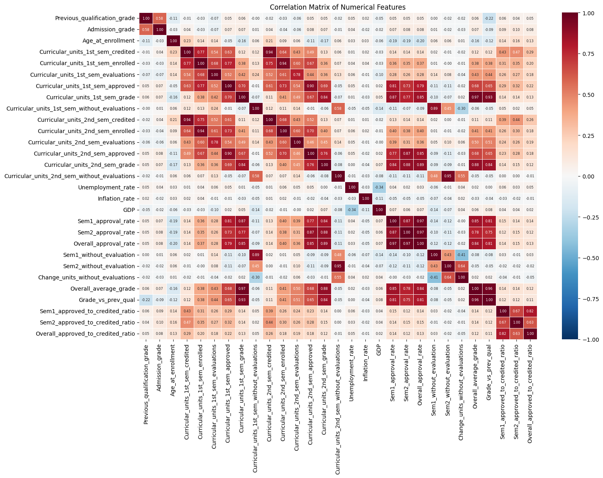

### 5.2 Phase A: Export for the Dashboard

The engineered data is saved as `data/processed/student.csv` (4,424 students) **before** any model-specific step, so
the dashboard shows real counts, grades and categories rather than transformed values.

### 5.3–5.6 Phase A: Cleaning, Transforming, Testing and Excluding

* **No column has a single value**, so nothing is removed for lack of information (48 columns at this point).
* **Taming long tails.** Of 22 lopsided columns, the **14 that are right-skewed and never negative** are
  log-transformed (led by units without evaluation and credited units). Grades and approval rates are skewed the
  other way and would get worse, and the change feature has negative values, so they are left as they are.
* **Statistical tests (descriptive).** A likelihood-ratio test confirms that the main numeric features carry real
  information (McFadden pseudo-R² 0.323). The **overall approval rate dominates** (LR = 1,533), followed by age
  (113). The approved-to-credited ratio (p = 0.19) and the change in unevaluated units (p = 0.76) add nothing. A
  chi-square test finds a link for 15 of 18 categories, strongest for **fee status** (Cramér's V = 0.43),
  scholarship (0.30), course (0.25), debt (0.24) and gender (0.23).
* **Excluded by design:** the three economic indicators, the four parental qualification and occupation codes, and
  entry route. Entry route is strongly linked to dropout, so the reason for excluding it is still to be documented.

### 5.7 Phase B: Stratified Split

The students are split into **90% training (3,981)** and **10% test (443)**. *Stratification* keeps the share of each
status identical in both parts (within 0.2 percentage points). The test students (142 dropouts, 80 enrolled,
221 graduates) are not touched again until Section 7.

### 5.8–5.10 Phase C: Learning from the Training Students Only

* **Statistical screening.** A chi-square test on the training students finds no link to status for
  **international** (p = 0.39), **nationality** (p = 0.44) and **special educational needs** (p = 0.68); all three
  are dropped. Ten categorical features remain.
* **Balancing.** Students are removed at random from the larger groups until every status has as many as the
  smallest: **714 of each (2,142 students)**. The cost: 1,839 training students are not used. Section 7.8 replaces
  this with class weights, which keep everyone.
* **Encoding and scaling.** Category codes become integers (codes not seen in training are handled safely), and
  numbers are rescaled to a 0–1 range. Both steps live inside the model pipeline, so they are refitted in every
  cross-validation fold and saved with the model.

### 5.11 Phase D: Ready for Modelling

The model receives **36 inputs** (10 categories and 26 numbers). The balanced training students (2,142) are used for
cross-validation and tuning; the 443 test students keep the real mix of statuses.

---

## 6. Modelling

### 6.1 Method and Search Space

**Random Forest** (Breiman, 2001) was the method required by the project brief. Its main weakness is a tendency to
memorise the training data, which tuning and cross-validation keep in check. Seven settings are tuned, including the
number of trees, the depth of each tree, how many characteristics each split may consider, and the minimum number of
students per split and per leaf.

### 6.2 Training Tools

One function builds the full pipeline (preparation + Random Forest), so cross-validation and tuning always refit the
preparation inside each fold. Every candidate is scored with **5-fold stratified cross-validation**: the training
students are split into five parts, the model learns on four and is checked on the fifth, in turn.

### 6.3 Starting Point

| Candidate | Accuracy | Macro F1 | Dropout recall |
|---|---|---|---|
| Majority status (dummy) | 0.332 | 0.166 | 0.600* |
| Random Forest, default settings | 0.711 | **0.712** | 0.695 |

\* An artefact: with perfectly balanced statuses, "most frequent" falls back to Dropout in some folds and flags
everyone there.

### 6.4 Tuning with Optuna

**Optuna** (Akiba et al., 2019) proposes new settings near the ones that scored well so far, and stops weak trials
early: after each fold, a trial whose running score is below the median of earlier trials is pruned. After
**50 trials** (36 completed, 14 stopped early), the best cross-validated macro F1 is **0.717**. Every trial is logged
to `artifacts/tuning/optuna_tuning_results.json`, so the search can be reloaded instead of rerun.

### 6.5 Choosing the Model

* **Winner:** 561 trees, fully grown (minimum one student per leaf), considering the square root of the features at
  each split.
* **Tuning adds little:** +0.005 macro F1 over the default settings. The five best trials score between 0.7159 and
  0.7166, so the search reached a plateau. The data and features matter far more than the settings.

---

## 7. Evaluation

The tuned model is tested on the 443 test students. Sections 7.1–7.7 assess this first iteration; Section 7.8
describes the second iteration that produced the final model.

### 7.1–7.2 First Iteration: Test Results

| Measure | Everyone graduates | Business rule | Random Forest (iteration 1) |
|---|---|---|---|
| Accuracy | 49.9% | 69.3% | **74.5%** |
| Macro F1 | 22.2% | 50.4% | **69.2%** |
| Dropout recall | 0% | 66.2% | **70.4%** |
| Dropout precision | — | 83.2% | **87.7%** |

* **The model beats both benchmarks on every measure.** It catches more dropouts than the rule and wastes fewer
  advisor contacts. The rule cannot recognise Enrolled students at all, which explains most of the macro F1 gap.
* **Overfitting.** Training accuracy is 95.9% against 74.5% on the test students, typical for fully grown trees.
* **The estimate is reliable.** Cross-validation (0.717) and test macro F1 (0.692) differ by only 2.5 points.

### 7.3 Performance by Status

| Status | Precision | Recall | F1 | Students |
|---|---|---|---|---|
| Dropout | 0.88 | 0.70 | 0.78 | 142 |
| Enrolled | 0.41 | 0.51 | 0.45 | 80 |
| Graduate | 0.83 | 0.86 | 0.84 | 221 |

* **Dropouts are flagged precisely, but 30% are missed,** mostly confused with Enrolled (32 of 142).
* **Only 14 students are wrongly flagged as dropouts.** That leaves room to flag more students and catch more
  dropouts.
* **Enrolled is the weak status:** an unfinished outcome that resembles both others.

### 7.4 What the Model Relies On

This is measured by **permutation importance**: shuffle one characteristic in the test data and see how much macro F1
drops.

* **Three factors drive the first model:** fee status (drop of about 0.040), overall approval rate (0.029) and age
  (0.013).
* **Debt and scholarship score close to zero,** although their dropout rates differ strongly. Their information
  overlaps with fee status and approval rate, so the model does not need them once those are known.

### 7.5 Did It Meet the Success Criteria? (Iteration 1)

| ID | Criterion | Evidence | Status |
|---|---|---|---|
| B1 | Model usable by the app | Pipeline, labels and metadata exported | Met |
| B2 | Drivers in recognisable terms | Fee status, approval rate, age | Met |
| B3 | Dashboard data in original units | `student.csv` exported | Met |
| D1 | Dropout recall ≥ 0.75 and above the rule | 0.704 against 0.662 | **Not met** (4.6 points short) |
| D2 | Macro F1 ≥ 0.70 | 0.692 | **Not met** (0.8 points short) |
| D3 | Cross-validation to test gap ≤ 5 points | 2.5 points | Met |
| D4 | Drivers agree with the exploration | Top three match | Met |

### 7.6 Reviewing the Process

**What worked**

* The leakage-safe order produced a test score within 2.5 points of cross-validation.
* Early stopping cut 14 of 50 weak trials, and every trial was logged to a reusable file.
* Keeping the original features made the drivers readable for staff.

**What to revisit**

* **Overfitting:** allow larger leaves and shallower trees.
* **Balancing:** compare class weights, which keep all 3,981 training students.
* **Redundant features:** the change in unevaluated units and the credited ratios add nothing.
* **Decision rule:** with only 14 false alarms, a lower flag line could catch more dropouts.

### 7.7 Decision (Iteration 1)

| Outcome | Decision |
|---|---|
| All data-mining criteria met | Pilot the model with advisors for one semester |
| D1 or D2 missed, but both benchmarks beaten | **Iterate:** tune the flag line, try class weights, then re-evaluate |
| The business rule is not beaten | Use the rule while improving the data |

**Decision: iterate** (the second row).

### 7.8 Second Iteration: The Final Model

Every choice in this iteration is made **on cross-validation of the training students only**. Two candidates are
compared on *out-of-fold* predictions, where each training student is predicted by a model that did not see them:

* **Candidate A:** the first-iteration settings, with balancing repeated inside each fold.
* **Candidate B:** a new Optuna study on **all 3,981 training students** with **class weights** (smaller statuses
  count more instead of removing students), shallower trees with larger leaves, and four low-value features removed.

**Candidate B wins on every measure even before the flag line is tuned** (macro F1 0.719 against 0.705), because it
learns from all training students. Its best settings use 394 trees, a maximum depth of 14, at least 5 students per
leaf and balanced class weights.

**From probability to flag.** By default a student gets the status with the highest probability. Instead, a student is
now **flagged as a dropout whenever the dropout probability reaches a flag line**; otherwise the more likely of
Enrolled and Graduate is chosen. Flag lines from 0.20 to 0.60 are scanned on the out-of-fold predictions, and the one
with the best macro F1 among those reaching 75% recall is kept. **Candidate B reaches the target at 0.37** (recall
0.754, precision 0.805, macro F1 0.706).

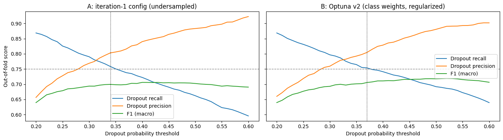

**Final results on the 443 test students**

| Measure | Business rule | Iteration 1 | **Final model (flag line 0.37)** |
|---|---|---|---|
| Dropout recall | 66.2% | 70.4% | **76.1%** |
| Dropout precision | 83.2% | **87.7%** | 83.7% |
| Accuracy | 69.3% | 74.5% | **75.6%** |
| Macro F1 | 50.4% | **69.2%** | 68.0% |

* **The final model catches 108 of 142 dropouts** (it missed 42 before, now 34).
* **The price is modest:** it flags 129 students instead of 114, with 21 false alarms instead of 14. For every 443
  students, advisors would contact about **15 more students to reach 8 more actual dropouts**.
* **Enrolled remains hard:** its recall falls from 0.51 to 0.36 (F1 0.40), which keeps macro F1 just below 0.70.
* **Less overfitting:** the regularised forest replaces fully grown trees.

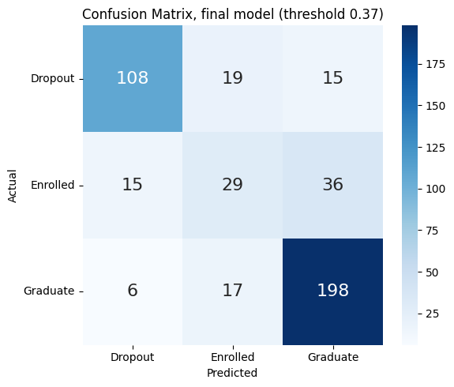

**What the final model relies on.** The **overall approval rate** (drop of about 0.084 in macro F1) and **fee status**
(0.037) lead by a wide margin, followed by the semester-2 approval rate and debt. Age, third in the first iteration, is
now close to zero; its information is most likely carried by correlated features such as attendance, marital status
and approval rates.

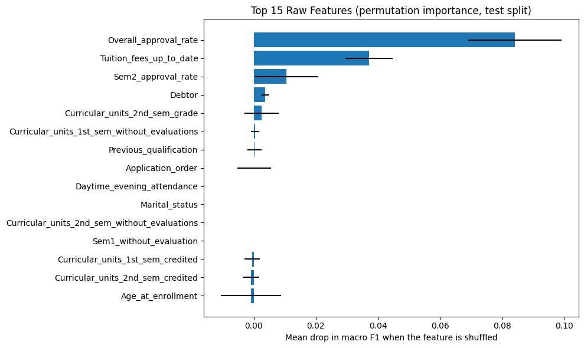

**Updated assessment**

| ID | Criterion | Evidence | Status |
|---|---|---|---|
| D1 | Dropout recall ≥ 0.75 and above the rule | 0.761 against 0.662 | **Met** |
| D2 | Macro F1 ≥ 0.70 | 0.680 | Not met (Enrolled status) |
| D3 | Cross-validation to test gap ≤ 5 points | 0.706 against 0.680 (2.6 points) | Met |
| D4 | Drivers agree with the exploration | Approval rate and fee status lead | Met |

**Decision.** The criterion that measures the early-warning use (D1) is now met, with precision above the business
rule. The recommendation is to present the trade-off to Academic Affairs and, if the Enrolled shortfall is accepted,
run a **supervised one-semester pilot that uses only the dropout flag**. Advisors review every flag; Enrolled and
Graduate predictions are not used for decisions.

---

## 8. Deployment

### 8.1 Exported Artifacts

The notebook exports everything the app needs:

* `artifacts/trained_models/random_forest_pipeline.joblib`: preparation and Random Forest in one pipeline, which
  accepts the original characteristics.
* `artifacts/trained_models/encoder_target.joblib`: translates predictions back into status labels.
* `artifacts/trained_models/model_metadata.joblib`: the feature list, the log-transformed columns, the selected
  settings and the **decision rule** (flag line 0.37).
* `artifacts/tuning/`: both Optuna trial logs.
* `data/processed/student.csv`: the engineered data for the dashboard.

### 8.2 Serving the Model

For each student, the app follows the notebook exactly: (1) rebuild the engineered features, (2) log-transform the
columns listed in the metadata, (3) select the model's features, (4) compute the probability of each status, and
(5) apply the decision rule. Calling the model's default prediction would ignore the tuned flag line, so the app never
does that.

**Monitoring** (owner: Data and IT team): track recall and precision every semester once outcomes are known, watch for
shifts in the inputs (for example the share of students in arrears), retrain at least once per academic year, and
review error rates per group (gender, age band, course).

### 8.3 The Early-Warning App

The Streamlit app is the advisors' and leadership's front end. It applies the saved model and decision rule in the
same order as the notebook and speaks plain language throughout: a risk verdict, the chance of dropping out, and
signals to discuss instead of statistics.

| Page | Question it answers | Main users |
|---|---|---|
| **Dashboard** | Who drops out, where is the risk concentrated, and how does first-year progress differ by final status? | Academic Affairs, programme directors, Admissions, Student Financial Services |
| **Student Check** | How likely is one student to drop out, and what could an advisor discuss first? | Academic advisors / tutors |
| **Batch Screening** | Which students in a cohort should advisors contact first? (CSV upload, ranked list, CSV download) | Academic advisors / tutors |
| **About the Model** | How reliable is the check, how does it work, and where should staff be careful? | All staff |

**Signals to discuss.** Student Check adds rule-based signals (fees in arrears, debt, few units passed, mature entry,
evening attendance), each with the office that can help and a dropout rate calculated from the records. They are
conversation starters taken from the analysis, not explanations of the model's reasoning.

**Design.** The layout follows the Murphys design system used across the portfolio apps (tinted sidebar, bordered KPI
cards, every chart with a "What this shows" caption and its data table). Typography takes its cue from MIT's brand
guidance: Arimo, the open equivalent of Arial, with tight headline leading, and Roboto Mono for small uppercase labels.
A status is always shown with an icon, a label and a colour.

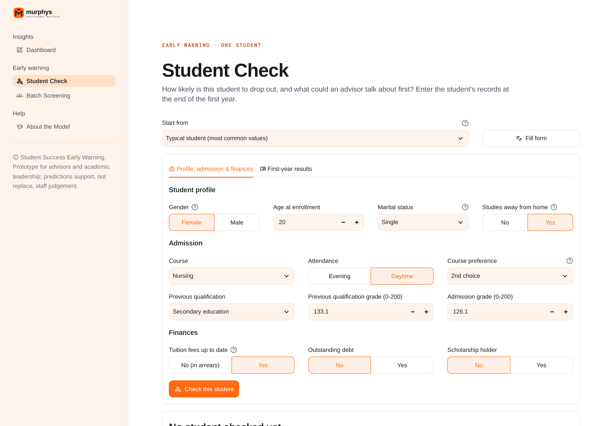

---

## 9. Conclusion and Recommendations

### 9.1 Conclusion

**In one sentence:** first-year approval rate and tuition-fee status are the clearest early signals of dropout, and
the final Random Forest, flagging students whose dropout probability reaches 0.37, catches 76% of dropouts with 84%
precision on unseen students, which meets the recall target and beats a simple business rule.

* **Prediction (Goal 1).** On 443 unseen students, the final model reaches 75.6% accuracy, 0.761 dropout recall,
  0.837 dropout precision and 0.680 macro F1. The second iteration raised recall by 5.6 points at the cost of 4 points
  of precision.
* **Risk factors (Goal 2).** Approval rate and fee status drive the model and are confirmed by the exploration, the
  statistical tests and both models. Age, debt, scholarship, evening attendance, entry route and course are strong
  markers in the rate tables, but their information overlaps with the two main drivers.
* **Delivery (Goal 3).** The dashboard data, the model with its decision rule, and both tuning logs are exported, and
  the Streamlit app is built on them.

Three caveats temper the result:

* **Enrolled students remain hard to identify** (F1 0.40), so macro F1 stays just below its target.
* **Fee status may be recorded late.** If arrears follow the decision to leave, part of the model's skill is leakage.
* **Real impact is not proven yet:** a supervised pilot is required.

### 9.2 Were the Problems Addressed?

1. **Early identification: addressed for the dropout flag** [D1, D3]. Students are flagged at the end of the first
   year, the recall target is met, and the estimate holds on new students. The three-status score (D2) is just short.
2. **Measured factors: addressed** [B2, D4]. Dropout rates, lifts and permutation importance quantify the main
   factors.
3. **An operational tool: addressed** [B1, B3]. The exported data and model power the Streamlit app with a dashboard,
   single-student and batch screening.

### 9.3 Were the Goals Achieved?

| Goal | Result | Status |
|---|---|---|
| 1. Predict status | Recall 0.761 (target ≥ 0.75), macro F1 0.680 (target ≥ 0.70), cross-validation to test gap 2.6 points | Partly achieved (D1, D3 met) |
| 2. Explain dropout factors | Approval rate and fee status lead; consistent with the exploration | Achieved |
| 3. Deliver the application | Data, model, decision rule and tuning logs exported; app built on them | Achieved |

### 9.4 Did It Make a Difference?

* **From counts to rates.** Reading dropout *rates* instead of raw counts revealed that small groups (students in
  arrears, debtors, mature entrants) carry most of the risk, reversing several conclusions of the original analysis.
* **Honest numbers.** Splitting before balancing replaced an inflated 79.5% accuracy with an honest estimate.
* **A decision rule, not just a score.** An explicit flag line turned a model that narrowly missed the recall target
  into one that meets it, and the rule travels with the model, so the app applies it exactly.
* **Reproducible and auditable.** Preparation and model are packaged together, and both tuning studies are logged.

### 9.5 Recommendations

Because the evidence is associational, each action should be piloted and reviewed before a full rollout.

1. **Review academic progress at the end of semester 1.** *Who: academic advisors / tutors.* Contact students who
   passed fewer than half of their semester-1 units, or none, and offer tutoring and a study-plan review before
   semester 2.
2. **Offer financial support early.** *Who: Student Financial Services.* Reach out as soon as fees fall into arrears
   or debt is recorded, with payment plans and emergency grants, and widen scholarship access for at-risk groups.
3. **Tailor onboarding for high-risk routes and courses.** *Who: Admissions office and programme directors.* Offer
   mature-student and evening-student onboarding (flexible scheduling, mentoring), and review course-level support in
   Equinculture, Informatics Engineering and Management (evening).
4. **Monitor the model.** *Who: Data and IT team.* Confirm when fee status is recorded, track recall, precision and
   per-group error rates every semester, and consider a two-way "dropout or not" model if the Enrolled status keeps
   limiting quality.
5. **Decide on the pilot, targets and fairness policy.** *Who: Academic Affairs leadership.* Accept or revise the
   macro F1 target, confirm that about 15 extra flags per 443 students fit advisor capacity, approve a supervised
   pilot, and decide whether gender and marital status may be used in individual decisions.

### 9.6 Limitations and Future Work

* **Proxy data.** One Portuguese polytechnic (2008/09 to 2018/19); results must be re-checked on the institution's own
  records.
* **What the label means.** "Enrolled" is an unfinished outcome measured at the end of the normal course duration,
  which explains its weak scores.
* **No dropout reason.** Voluntary withdrawal and dismissal cannot be distinguished.
* **Timing of fee status.** It is the second most important input; if recorded after disengagement, the model's skill
  is overstated.
* **Test students used twice:** once for each iteration. All second-iteration choices were made on cross-validation,
  but the final figures are slightly less independent than a single look.
* **Small test set.** 443 students (80 Enrolled), so results per status carry noticeable uncertainty.
* **Links, not causes.** Rates and model importance describe patterns, not causal effects.

---

## How to Run

**The quickest way:** start the app on your own computer (below). Nothing needs to be trained: the repository already
includes the trained model in `artifacts/trained_models/`, the dashboard data in `data/processed/`, and the code
tables in `data/reference/`.

### What you need

* **Python 3.11 or newer**
* **Git**, to download the repository

The model files were saved with **scikit-learn 1.6.1**, so the pinned versions in the requirements files matter.

### 1. Download the project

```bash
git clone https://github.com/DcMurphys/institute-student-dropout-prediction.git
cd institute-student-dropout-prediction
```

### 2. Install the dependencies

Create a separate Python environment, so the project does not affect other Python work on your computer. It is named
like the repository and is ignored by Git:

```bash
python3.11 -m venv institute-student-dropout-prediction
source institute-student-dropout-prediction/bin/activate   # Windows: institute-student-dropout-prediction\Scripts\activate
pip install -r requirements-dev.txt                        # notebook, app, tests and lint
```

To install only what the app needs:

```bash
pip install -r app/requirements.txt
```

### 3. Start the app

```bash
streamlit run app/main.py
```

The app opens at http://localhost:8501. Batch Screening includes a **Try with sample file** button and a downloadable
template, so it can be tried without real data.

### 4. Run the tests (optional)

The tests check that the engineered features match the notebook, that the model applies the 0.37 decision rule, the
dashboard calculations, the support signals, and that every app page renders without technical jargon.

```bash
python -m pytest -q
ruff check app tests && ruff format --check app tests
```

### 5. Re-run the analysis (optional)

Open `notebooks/student_dropout_prediction.ipynb` in Jupyter. Both Optuna studies are reloaded from
`artifacts/tuning/` by default, so a full run does not repeat the search. A full run re-exports the model files and
`data/processed/student.csv`; after any retraining, update `data/reference/model_performance.json` and the figures in
this README.

### 6. Deploy (optional)

* **GitHub.** Secrets belong in `.streamlit/secrets.toml`, which is ignored; the app needs none.
* **Streamlit Community Cloud.** The live demo runs at
  [murphys-polytechnic-dropout.streamlit.app](https://murphys-polytechnic-dropout.streamlit.app/). To deploy a copy,
  create an app from the repository with the main file `app/main.py` and Python 3.11 or newer. Dependencies come from
  `app/requirements.txt`, and the theme and self-hosted fonts from `.streamlit/config.toml`.
* **Keeping the demo awake.** Community Cloud puts quiet apps to sleep, and a plain HTTP ping does not wake them. The
  workflow `.github/workflows/keep-alive.yml` opens the app in a headless browser every 6 hours and presses the wake-up
  button when needed. It can also be started by hand under *Actions → Keep Streamlit app awake → Run workflow*.

### Project layout

| Folder | Contents |
|---|---|
| `notebooks/` | The analysis notebook, the source of every number in this README |
| `data/` | `raw/` (original dataset), `processed/` (engineered data for the dashboard), `reference/` (code-to-label tables and model performance figures) |
| `artifacts/` | `trained_models/` (pipeline, status labels, metadata with the 0.37 flag line), `tuning/` (Optuna trial logs) |
| `app/` | The Streamlit app in a Model-View-Controller layout: `models/` (data and prediction logic, no Streamlit), `views/` (page rendering), `controllers/` (navigation and caching), plus logo and fonts |
| `tests/` | Automated tests |
| `docs/` | `REVISION_REPORT.md` (history of the notebook revision) and `images/` (figures used in this README) |
| `.streamlit/` | App theme, fonts and upload limit |
| `.github/workflows/` | The scheduled workflow that keeps the live demo awake |

---

## Glossary

| Term | Meaning |
|---|---|
| **Dropout rate** | The share of students in a group whose final status is Dropout. |
| **Lift** | A group's dropout rate divided by the average rate. 2.0 means twice as likely to drop out as the average student. |
| **Approval rate** | Units passed divided by units enrolled in a semester. |
| **Enrolled** | Not finished at the end of the normal course duration (three years; four for Nursing). |
| **Data leakage** | Giving a model information it would not have when it makes a real prediction. It makes results look better than they are. |
| **Stratified split** | Dividing students into training and test sets while keeping the share of each status the same in both. |
| **Chi-square test** | A test of whether the mix of statuses differs between the categories of a characteristic. |
| **Likelihood-ratio test** | A test of whether a group of numeric characteristics improves the prediction of status. |
| **Cramér's V** | The strength of a link between two categories, from 0 (none) to 1 (perfect). |
| **Pearson correlation (r)** | How closely two numbers move together in a straight line, from −1 to +1. |
| **Log transformation** | Compressing large values so that a few very high counts do not dominate. |
| **Balancing (undersampling)** | Randomly removing students from the larger groups so every status is equally represented. |
| **Class weights** | Making the smaller statuses count more during training instead of removing students. |
| **Random Forest** | A machine-learning method that combines the votes of many decision trees. |
| **Cross-validation** | Testing a model several times, each time training on part of the data and checking on the rest. |
| **Out-of-fold prediction** | A prediction for a training student made by a model that did not see that student. |
| **Recall / precision** | The share of dropouts the model flags / the share of flagged students who actually drop out. |
| **F1 / macro F1** | A balance of precision and recall / its average over the three statuses with equal weight. |
| **Flag line (threshold)** | The dropout probability from which a student is flagged for follow-up; here 0.37. |
| **Permutation importance** | How much worse the model gets when one characteristic is shuffled. |
| **Optuna** | A tool that searches for good model settings efficiently. |
| **CRISP-DM** | A standard step-by-step method for data projects. |

---

## References

Citations follow APA 7th edition.

### Official and industry reports

OECD. (2022). *Education at a glance 2022: OECD indicators*. OECD Publishing. https://doi.org/10.1787/3197152b-en

### Scientific papers

Akiba, T., Sano, S., Yanase, T., Ohta, T., & Koyama, M. (2019). Optuna: A next-generation hyperparameter optimization
framework. In *Proceedings of the 25th ACM SIGKDD International Conference on Knowledge Discovery & Data Mining*
(pp. 2623–2631). ACM. https://doi.org/10.1145/3292500.3330701

Breiman, L. (2001). Random forests. *Machine Learning, 45*(1), 5–32. https://doi.org/10.1023/A:1010933404324

He, H., & Garcia, E. A. (2009). Learning from imbalanced data. *IEEE Transactions on Knowledge and Data Engineering,
21*(9), 1263–1284. https://doi.org/10.1109/TKDE.2008.239

Kaufman, S., Rosset, S., Perlich, C., & Stitelman, O. (2012). Leakage in data mining: Formulation, detection, and
avoidance. *ACM Transactions on Knowledge Discovery from Data, 6*(4), 1–21. https://doi.org/10.1145/2382577.2382579

Martins, M. V., Tolledo, D., Machado, J., Baptista, L. M. T., & Realinho, V. (2021). Early prediction of student's
performance in higher education: A case study. In *Trends and applications in information systems and technologies*
(Advances in Intelligent Systems and Computing, pp. 166–175). Springer. https://doi.org/10.1007/978-3-030-72657-7_16

Realinho, V., Machado, J., Baptista, L., & Martins, M. V. (2022). Predicting student dropout and academic success.
*Data, 7*(11), 146. https://doi.org/10.3390/data7110146

Tinto, V. (1975). Dropout from higher education: A theoretical synthesis of recent research. *Review of Educational
Research, 45*(1), 89–125. https://doi.org/10.3102/00346543045001089

### Data sets and software

Dicoding Academy. (n.d.). *Students performance dataset* [Data set]. GitHub.
https://github.com/dicodingacademy/dicoding_dataset/tree/main/students_performance

Pedregosa, F., Varoquaux, G., Gramfort, A., Michel, V., Thirion, B., Grisel, O., Blondel, M., Prettenhofer, P.,
Weiss, R., Dubourg, V., Vanderplas, J., Passos, A., Cournapeau, D., Brucher, M., Perrot, M., & Duchesnay, É. (2011).
Scikit-learn: Machine learning in Python. *Journal of Machine Learning Research, 12*, 2825–2830.
https://jmlr.org/papers/v12/pedregosa11a.html

Realinho, V., Vieira Martins, M., Machado, J., & Baptista, L. (2021). *Predict students' dropout and academic success*
[Data set]. UCI Machine Learning Repository. https://doi.org/10.24432/C5MC89

---

## License

The code in this repository is released under the [MIT License](LICENSE), © 2026 Dwi Cahaya Dharma.

The licence does not cover material owned by others:

* **Data:** the *Predict Students' Dropout and Academic Success* dataset (Realinho et al., 2021) is published on the
  UCI Machine Learning Repository under the Creative Commons Attribution 4.0 International licence (CC BY 4.0). The
  derived files in `data/processed/` and `data/reference/` come from that dataset and keep its licence.
* **Fonts:** Arimo and Roboto Mono in `app/static/fonts/` are licensed under the SIL Open Font License 1.1 (see
  `Arimo-LICENSE.txt` and `RobotoMono-LICENSE.txt`).
* **Institution:** Murphys Polytechnic Institute, its name and logo are fictional and created for this portfolio.
